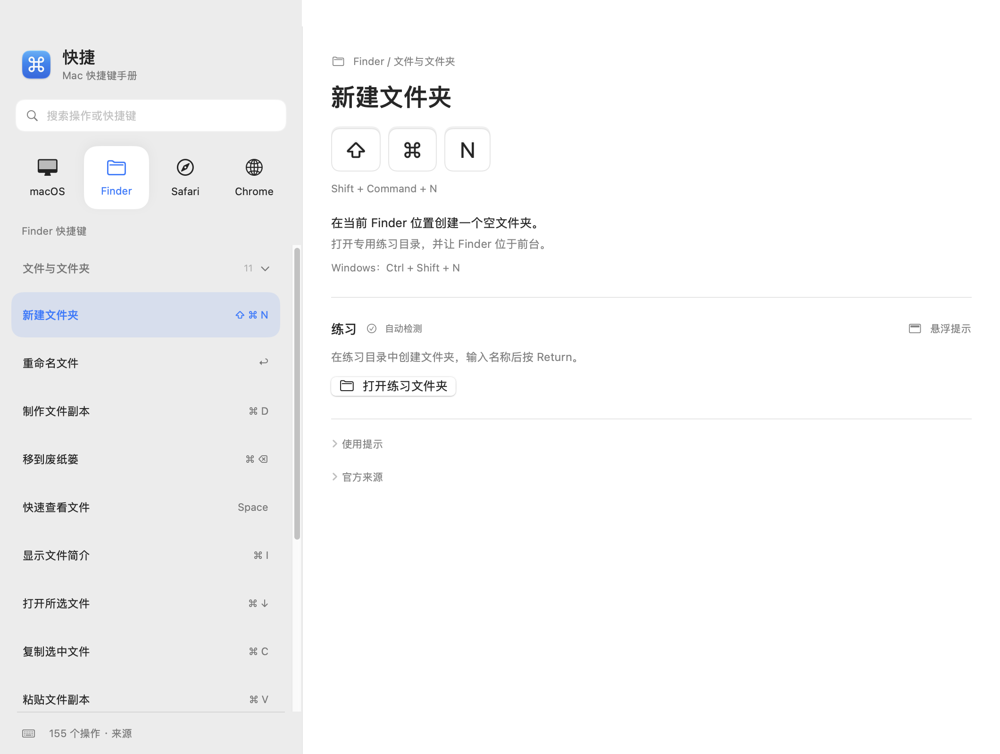
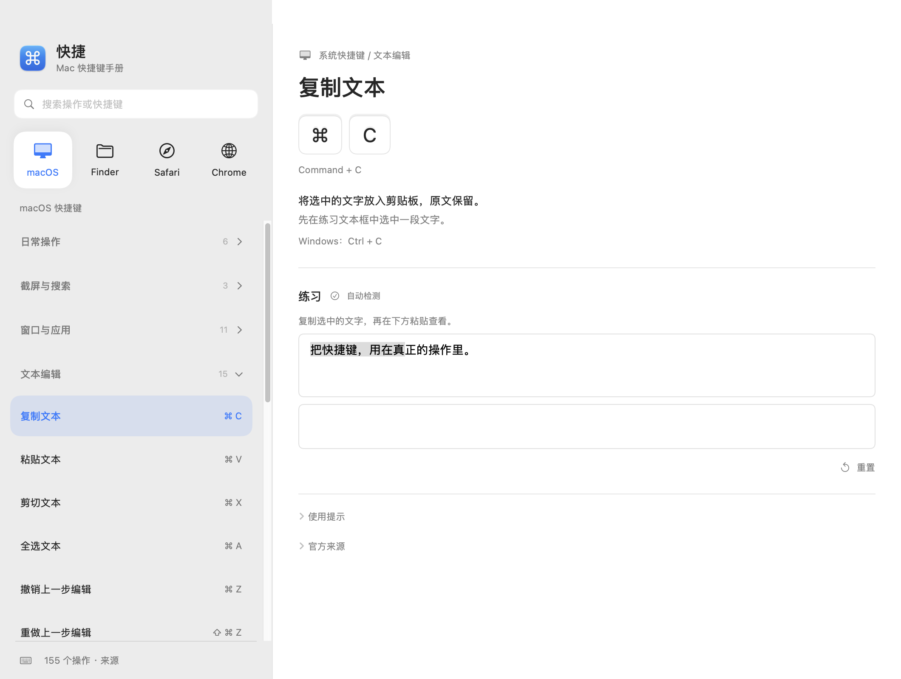

# QuickKey · 快捷

English | [简体中文](README.zh-CN.md)

A native macOS keyboard shortcut reference with hands-on practice. Built with SwiftUI and AppKit.

## Screenshots

### Shortcut reference



### Text editing practice



## Features

- Browse shortcuts for macOS, Finder, Safari, and Chrome by category.
- Practice text editing, file operations, and window controls with feedback where supported.
- Works offline. No third-party runtime dependencies or Accessibility permission required.

## Download & Install

Requires **macOS 14 or later**. The prebuilt release supports **Apple Silicon (arm64)**.

1. Download the `.dmg` from [Releases](https://github.com/ssimbass/quickkey/releases/latest).
2. Open it and drag **QuickKey** to **Applications**.
3. Launch QuickKey from Applications.

The app is ad-hoc signed and **not Apple-notarized**. If macOS blocks it, try opening it once, then go to **System Settings → Privacy & Security → Open Anyway** and confirm. [Apple instructions](https://support.apple.com/102445).

## Build

Requires a **Swift 6 toolchain** on macOS.

```sh
git clone https://github.com/ssimbass/quickkey.git
cd quickkey
./scripts/build-app.sh
open dist/QuickKey.app
```

Create a release DMG:

```sh
./scripts/build-dmg.sh
```

## Development

```sh
./scripts/check-publication.py
./scripts/check-core.sh
swift test # Requires XCTest, available with full Xcode.
```

See [Contributing](CONTRIBUTING.md), [Changelog](CHANGELOG.md), and [Security](SECURITY.md).

## Privacy

Practice uses local text, the system clipboard, and dedicated sample files. No practice content is uploaded. Some external actions require manual confirmation; see [Security & Privacy](SECURITY.md).

## License

[MIT](LICENSE). Shortcut references are sourced from Apple and Google documentation. This project is not affiliated with Apple or Google.
